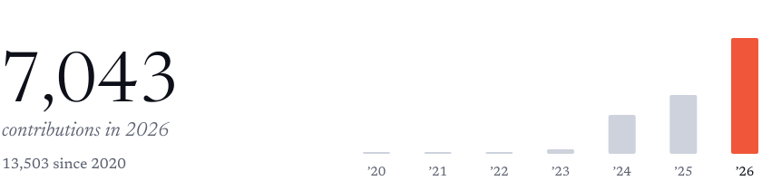

<picture>
  <source media="(prefers-color-scheme: dark)" srcset="header-dark.svg">
  
</picture>

a decade in music first, then venture, now agents.

### now

**[immiscible](https://immiscible.fly.dev)** · before an agent does something it can't take back, a person gets asked 
**[assay-guard](https://github.com/eoinforker/assay-guard)** · stops prompt-injected agents leaking your secrets

### before

**2026** &nbsp;[alumni ventures](https://av.vc) · ai associate, emea 
**2025** &nbsp;started solo-building my own software 
**2024** &nbsp;[electrify](https://www.electrify.video) · creator partnerships 
**2024** &nbsp;a1 advisory · vc partnerships 
**2020** &nbsp;out of hours · artist management 
**2019** &nbsp;[akira records](https://www.akirarecords.com) · label operations 
**2015** &nbsp;[surreal recordings](https://surrealrecordings.bandcamp.com) · co-founded at 16

 

<picture>
  <source media="(prefers-color-scheme: dark)" srcset="contributions-dark.svg">
  
</picture>
