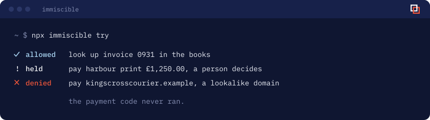

I build [immiscible](https://immiscible.ai): agents ask a person before they do something they can’t take back. Also [idyll](https://eoinforker.github.io/idyll-site/) and [assay-guard](https://github.com/eoinforker/assay-guard). Before this: [alumni ventures](https://av.vc), [electrify](https://www.electrify.video), out of hours, [akira records](https://www.akirarecords.com), and [surreal recordings](https://surrealrecordings.bandcamp.com), which I co-founded at 16.

**[idyll](https://eoinforker.github.io/idyll-site/)**, social without the scroll. The feeds come out of nine social apps, and your friends stay. Free, for good. Coming to iPhone, Android and Chrome.
 

<picture>
  <source media="(prefers-color-scheme: dark)" srcset="notebook-dark.svg">
  
</picture>
